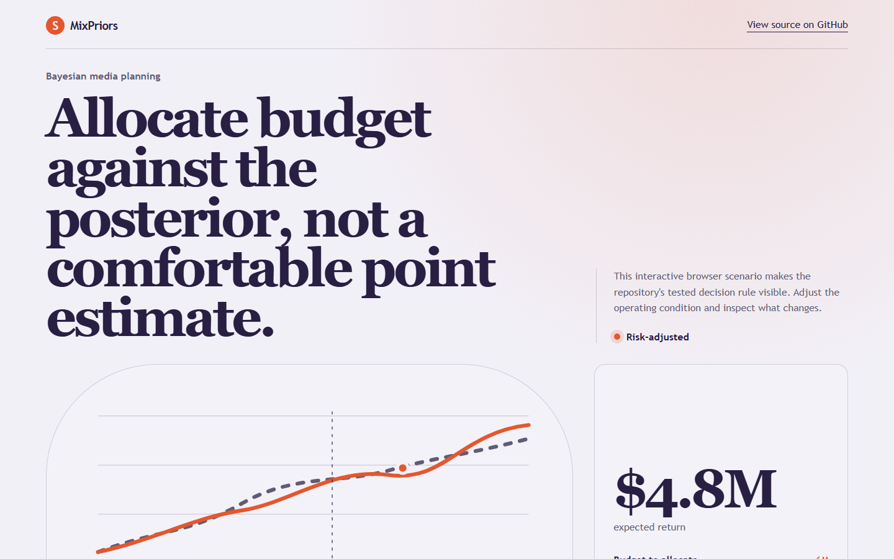
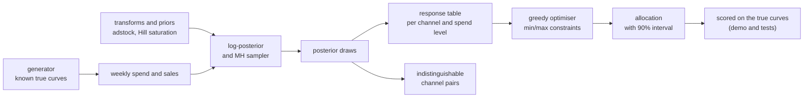

# mixpriors

A Bayesian media mix model whose budget optimiser maximises expected return under the posterior, not under a point estimate. Pure Python standard library, no dependencies.

[](https://github.com/SlateGitOrg/mixpriors/actions/workflows/ci.yml)
[Live demo](https://slategitorg.github.io/mixpriors/)



## Why

A marketing team has to split roughly GBP 45M a year across nine channels, but weekly aggregate data gives only about 150 observations to estimate nine channel effects plus seasonality and a baseline. An unconstrained fit will happily report that radio hurts sales or that out-of-home returns 14x. Both are noise, and the budget then moves on that noise.

mixpriors keeps the uncertainty. Adstock (carryover) and saturation parameters get informative, written-down priors; the sampler returns a full posterior; and the optimiser scores every candidate allocation across all posterior draws, so a channel with a high mean but a wide interval is not over-funded. The recommendation comes with a credible interval instead of a single number.

## Features

- Geometric adstock and Hill saturation transforms, with a justified prior per channel (`src/transforms.py`).
- A hand-written Metropolis-Hastings sampler with per-channel block updates and burn-in step adaptation (`src/model.py`).
- A tight baseline prior that stops the baseline from absorbing the media contribution.
- A synthetic data generator with known true response curves, partial inter-channel collinearity, seasonality and budget drift, so parameter recovery can be tested directly (`src/generator.py`).
- A greedy budget optimiser with per-channel minimum and maximum constraints, evaluated as the expectation over posterior draws of a flighted 52-week plan.
- The point-estimate shortcut (collapse the posterior to its mean, then optimise) included as a baseline, so the two can be compared on the true curves.
- Reporting of channel pairs whose coefficient intervals overlap heavily, instead of splitting credit between them arbitrarily.
- A browser lab in `site/` (deployed to GitHub Pages) that runs a simplified, risk-penalised allocation in JavaScript.

## Architecture



Data (synthetic here) flows into a log-posterior built from the transforms and priors. The sampler produces draws. The optimiser precomputes expected annual response per channel at each spend level across the draws, then allocates greedily by marginal gain. Because the generator knows the true curves, the final allocation can be scored on a surface the optimiser never saw. See [docs/ARCHITECTURE.md](docs/ARCHITECTURE.md) for the decisions in detail.

## Quick start

Requires Python 3.11 or newer. There is nothing to install: the model uses only the standard library.

```bash
git clone https://github.com/SlateGitOrg/mixpriors.git
cd mixpriors
python -m src.demo                        # full pipeline, about 5 seconds
python -m unittest discover -s tests -v   # 23 tests, about 20 seconds
```

For the browser lab, Node.js 20 or newer:

```bash
node --test site/core.test.mjs
python -m http.server -d site 8000        # then open http://localhost:8000
```

## Example

`python -m src.demo` generates 156 weeks of data, fits the model, optimises a budget and scores the result. Trimmed output:

```text
  MIXPRIORS - 156 weekly observations, 29 parameters, GBP 45M to split
  156 weeks, 9 channels, GBP 45,240,000 annual budget.
  Sampler acceptance 51%, 1000 retained draws.

    channel          true   posterior mean          90% interval   covers
    tv               0.30             0.25          [0.15, 0.33]      yes
    paid_search      0.34             0.20          [0.07, 0.41]      yes
    podcast          0.03             0.02          [0.01, 0.04]      yes
    9/9 true values inside their intervals.

    18% of the budget reallocated, spend unchanged.
    expected annual response: 38,734,574
    90% credible interval:    [13,753,659, 68,506,522]

  SCORED ON THE TRUE CURVES (which the optimiser never saw)
    incumbent plan                  38,134,403
    posterior-aware                 39,189,118    +2.77%
    point-estimate                  37,684,247    -1.18%

    (11 pairs whose coefficient intervals overlap heavily)
```

The seeds are fixed, so the output is reproducible. The credible interval on the expected response is wide, and that is the point: the data on 156 weeks does not pin the answer down, and the model says so. On the true curves the posterior-aware allocation beats the incumbent plan by 2.77%, while the same posterior collapsed to its mean loses 1.18%.

## How it works

- **Priors.** Each channel has a Beta prior on decay, a log-normal prior on the half-saturation point, and a half-normal prior on its coefficient, each with a one-line justification (TV carries over for weeks; search is intent capture with almost no carryover). A test asserts every prior has one.
- **Baseline.** The baseline and the media coefficients are confounded. A diffuse baseline prior lets the sampler drift to high-baseline, near-zero-media solutions that fit well and understate media. The baseline prior is tight, standing in for what zero-spend periods would show in practice.
- **Sampling.** Updating all parameters at once rejects almost every proposal, so the sampler updates one channel's three parameters at a time and adapts step sizes toward a 25% acceptance target during burn-in only.
- **Expectation, not mean.** The response curve is concave, so the response at the posterior mean parameters is not the mean response. Likewise, response at average weekly spend is not the response to a flighted plan. The optimiser evaluates every draw against flighted weekly spend, using a precomputed response table so the greedy search stays fast.
- **Identifiability.** Pairs of channels whose 90% intervals overlap by more than half the wider interval are reported as indistinguishable.

## Testing

`python -m unittest discover -s tests -v` runs 23 tests in `tests/test_recovery.py`:

- sampler: the chain moves, yields enough draws, and improves on the prior's fit;
- recovery: true coefficients fall inside their intervals, the baseline does not absorb media, no channel is reported as harmful, search carryover is shorter than TV;
- uncertainty: collinear channels are flagged and small channels have wide intervals;
- optimiser: beats the incumbent plan on the true surface, beats the point-estimate shortcut, respects constraints, refuses impossible ones, carries an interval;
- transforms: adstock, saturation and prior sanity.

`node --test site/core.test.mjs` and `python scripts/validate_site.py` check the browser lab. CI runs all three.

## Project layout

```
src/
  transforms.py   adstock, Hill saturation, priors and log-densities
  generator.py    synthetic data with known true curves
  model.py        log-posterior, sampler, optimiser, identifiability report
  demo.py         end-to-end demo
tests/            recovery, uncertainty and optimiser tests
site/             browser lab deployed to GitHub Pages
scripts/          site validation
docs/             architecture notes and screenshots
```

## Limitations

- The data is synthetic. The generator is realistic in structure but is not a real brand's history.
- The sampler is plain Metropolis-Hastings: simple and inspectable, but slower and less efficient than NUTS. A production fit would use NumPyro or Stan.
- The baseline prior is hand-set around the generator's true value, and the optimiser is greedy rather than exact.
- There is no hierarchical pooling and no geo-experiment calibration yet; those would enter as extra prior terms.
- The browser lab uses a simplified exponential-saturation model with a risk penalty, not the Bayesian model above.

## License

MIT — see [LICENSE](LICENSE).
