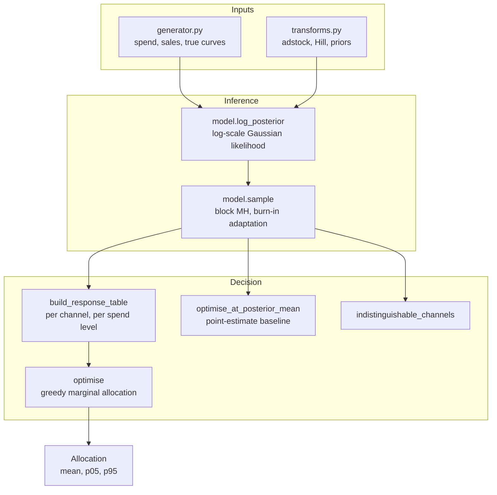

# Architecture

## Context

Media mix models answer a budget question: if spend moves from channel A to channel B, what happens to sales? With about 150 weekly observations and nine channels, the data alone does not identify the answer. mixpriors makes the missing information explicit as priors, carries the resulting uncertainty through to the allocation, and checks the whole chain against synthetic data whose true response curves are known.

## Components

## Key decisions

**Optimise the expectation over the posterior.** The response curve is concave, so the response at the posterior-mean parameters is not the mean response. Collapsing to the mean first over-credits channels whose high mean comes from a few extreme draws. `optimise` evaluates every draw (thinned to at most 80 for speed) and sums per-channel expected responses; `optimise_at_posterior_mean` is kept as an explicit comparison. In the demo on the true curves the posterior-aware plan is +2.77% against the incumbent and the collapsed plan is -1.18%.

**Evaluate flighted spend, not average spend.** The model is fitted on bursty weekly spend. Evaluating a plan at its average weekly level over-credits channels bought in bursts, so each channel's weekly level is multiplied by a flighting profile before adstock and saturation are applied.

**Tight baseline prior.** Baseline sales and media coefficients are confounded. With a diffuse baseline prior the chain drifts to high baseline and near-zero media. The prior is a log-normal with sigma 0.03, representing a baseline read from near-zero-spend periods.

**Hand-written Metropolis-Hastings.** It is slower than NUTS, but every term of the posterior and the accept/reject step is visible. It updates one channel's three parameters per step (a global block handles baseline and noise) and adapts each block's step size toward a 25% acceptance rate during burn-in only, since adapting on kept draws would break stationarity.

**Precomputed response table.** Adstock is linear in spend level, so the adstocked profile is computed once per draw and decay, then scaled. The greedy optimiser becomes table lookups instead of a posterior sweep per candidate move.

**Synthetic data with known truth.** Held-out fit says little about whether reallocation advice is right. The generator includes budget drift (otherwise saturation is not identified), seasonality, and partial collinearity between paid search and paid social (exact proportionality would make them unidentifiable rather than hard to separate).

## Failure modes

- Under-sampled posterior: intervals too narrow and allocations worse than the incumbent. Tests use 4,000 draws after 1,500 of burn-in.
- Impossible constraints: `optimise` raises `ValueError` when the channel minimums exceed the budget.
- Collinear channels: reported by `indistinguishable_channels` rather than given an arbitrary split.
- Greedy allocation: reasonable under concave per-channel curves, but not guaranteed optimal in general.

## Out of scope

- Real client data ingestion and warehouse integration.
- Hierarchical pooling across regions or products, and geo-experiment calibration. Both would enter as additional prior terms.
- Gradient-based samplers; a production fit would use NumPyro or Stan.
- The browser lab in `site/` is a simplified exponential-saturation allocator with a risk penalty. It illustrates the idea and does not run the Bayesian model.
